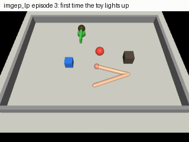
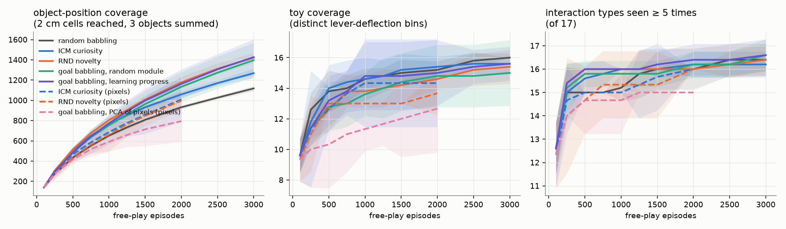
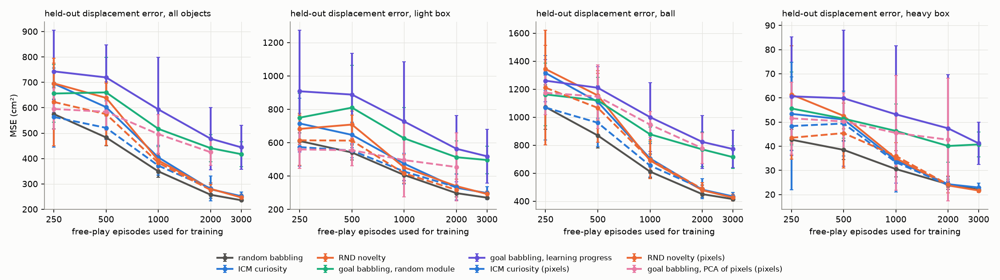
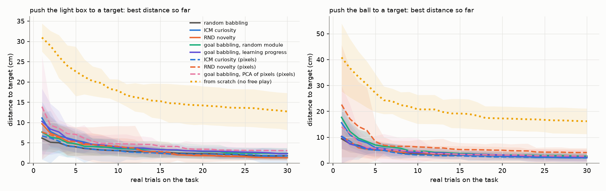
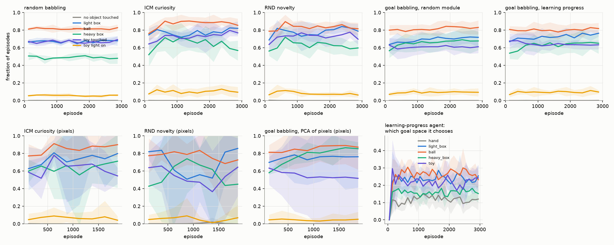

# cribworld: a simulated arm that learns by playing



cribworld is a small MuJoCo testbed where a two-joint arm plays with four objects, with no task and no reward from outside, and has to find out what its own movements do to the world. Over 5 seeds, novelty-seeking (RND) and goal babbling reached about 27% more object positions than random motor babbling, and goal babbling produced rare outcomes, such as shoving the heavy box 15 cm, 4 to 5 times as often. Free play of any kind made a later pushing task about 7 times more precise than learning it from scratch, but random babbling was as useful there as every intrinsically motivated agent, and the body-then-objects-then-toy stages did not emerge.

<!-- TODO(Tommaso): your own words on why -->

## Usage

```bash
python3.12 -m venv .venv && source .venv/bin/activate
pip install -e ".[dev]"
pytest -q                                   # about 30 s

bash scripts/reproduce.sh configs/smoke.yaml   # whole pipeline in minutes, tiny budget
bash scripts/reproduce.sh                      # full experiment, about 1 hour on a busy M-series Mac, one process
```

`scripts/reproduce.sh` runs, in order: `freeplay.py` (every agent and seed, one after the other; it waits
when less than 25% of RAM is free on macOS), `heldout.py` (held-out interactions and task targets),
`evaluate.py`, `downstream.py`, `figures.py` and `gif.py`. Finished runs are skipped, so an interrupted
run resumes. Raw free-play logs are in `results/freeplay/`, all numbers in `results/summary.md`.
Rendering is headless: `MUJOCO_GL=cgl` on macOS, `egl` on Linux.

## The setup

A planar two-joint arm sits at the edge of a walled table. On the table: a light box (50 g, slides far),
a ball (rolls, and often keeps rolling into a wall), a heavy box (700 g, high friction, moves only under
a strong push) and a toy far from the body: a spring-loaded lever that lights a lamp when swung more than
0.5 rad. The lamp stays on until the end of the episode, so it is visible in the last camera frame.

One episode is one movement. The agent outputs a command $\theta \in [-1,1]^6$, three joint-space
via-points that a position controller visits for 0.3 s each, followed by 0.3 s of rest. The scene is
reset after every episode, with the objects' start positions jittered by up to 1.5 cm.

What the agent senses at the start and end of an episode:

* body: joint angles (as cos and sin), joint velocities, peak hand touch, whether the arm touched anything;
* world, in one of two settings: a 32×32 RGB image from a camera above the shoulder (`pixels`), or the
  object positions and lever deflection read from the simulator (`state`, the oracle setting).

No language, no pretrained network, no reward from outside during free play.

The framing follows two lines of work. Developmental psychology argues that infants build understanding
through a body that acts and explores (Smith and Gasser 2005). Intrinsic-motivation research gives machines
a drive to do this: rewards for prediction error, novelty or learning progress instead of for a task
(Schmidhuber 2010; Oudeyer, Kaplan and Hafner 2007). Haber et al. (2018) trained a world model together
with a self-model that predicts the world model's errors and reported object-directed play emerging in a
3D environment. This repo is a much smaller, CPU-sized comparison of such drives on one body.

## Agents

All agents get the same budget (3000 episodes in the state setting, 2000 in the pixel setting) and the
same first 100 random episodes. They differ only in how they choose the next command.

| agent | how it picks $\theta$ |
|---|---|
| random babbling | $\theta \sim \mathcal U([-1,1]^6)$ |
| ICM curiosity (Pathak et al. 2017) | plays where its forward model in a learned feature space is most wrong |
| RND novelty (Burda et al. 2019) | plays where it cannot yet predict a fixed random network of the final observation |
| goal babbling, random module | IMGEP (Forestier et al. 2017): picks one goal space at random, a goal in it, then tries to reach it |
| goal babbling, learning progress | same, but picks the goal space where its competence is changing fastest (Baranes and Oudeyer 2013) |
| goal babbling, PCA of pixels | pixel setting only: goals in a PCA latent space of the camera images (cf. Péré et al. 2018) |

## How it works

### Forward models

ICM encodes an observation $o$ into features $\phi(o)$ and trains an inverse model
$g$ and a forward model $f$ together:

$$
\mathcal L = (1-\beta)\,\bigl\lVert g(\phi(o_0),\phi(o_1)) - \theta \bigr\rVert^2
+ \beta\,\tfrac12 \bigl\lVert f(\phi(o_0),\theta) - \phi(o_1) \bigr\rVert^2 ,\qquad \beta = 0.2 .
$$

The inverse loss shapes the features toward what the arm controls; the forward loss is the prediction
being tested.

### Curiosity reward

ICM uses the forward error, RND the error of a trained predictor $\hat h$ against a
frozen random network $h$:

$$
r^{\text{ICM}} = \tfrac12 \bigl\lVert f(\phi(o_0),\theta) - \phi(o_1) \bigr\rVert^2 ,\qquad
r^{\text{RND}} = \bigl\lVert \hat h(o_1) - h(o_1) \bigr\rVert^2 .
$$

Because one episode is one decision, the curiosity agents are one-step: a critic $Q(\theta)$ regresses
the normalised reward of the last 1000 episodes (recomputed with the current models every 50 episodes),
and the agent plays the best of 64 random candidates, or a random command with probability 0.1.

### Goal babbling

Outcomes live in five modules: hand position, light box, ball, heavy box (each a final
$xy$ position) and toy (peak lever angle). Each episode the agent picks a module $m$, samples a goal
$g$ uniformly in the range of outcomes seen so far in $m$ (expanded by 10%), finds the stored command
whose outcome in $m$ was nearest,

$$
j = \arg\min_i \bigl\lVert (o_i^m - g)/s^m \bigr\rVert ,
$$

where $s^m$ is the module's range, and plays $\theta = \theta_j + \varepsilon$, $\varepsilon \sim \mathcal N(0, 0.05^2 I)$.
Whatever the goal, the outcomes in every module are stored.

### Learning progress

For a goal in module $m$, $d_{\text{ref}}$ is the distance of the nearest stored
outcome and $d$ the distance actually reached. The progress is $p = \lvert d_{\text{ref}} - d \rvert$ and the
interest of a module is its mean over the last 50 goals:

$$
\mathrm{LP}_m = \frac{1}{50} \sum_{k=1}^{50} \bigl\lvert d_{\text{ref},k} - d_k \bigr\rvert ,\qquad
P(m) = \frac{\epsilon}{M} + (1-\epsilon)\,\frac{\mathrm{LP}_m}{\sum_{m'} \mathrm{LP}_{m'}} ,\qquad \epsilon = 0.2 .
$$

A module where nothing changes (the agent cannot move the object, or already reaches every goal) gets
little interest; one where outcomes are shifting gets more.

## Metrics

All metrics use simulator ground truth, never the agent's own beliefs.

* **Coverage**: distinct 2 cm cells reached by the final position of each object, summed over the three
  objects; distinct 0.07 rad bins of peak lever angle for the toy.
* **Interaction types**: 17 detectors (touching each object, moving it more than 2 or 10 cm, lighting
  the toy, objects hitting objects or walls, and four rare outcomes such as swinging the lever past 1 rad
  or pushing the light box to the back of the table). A type counts as discovered once seen 5 times.
* **Held-out forward model**: a fresh MLP of fixed size is trained on each agent's data to predict object
  displacements and lever angle from (start positions, $\theta$), and tested on 1000 held-out interactions.
  The held-out pool comes from all five state agents run on a seed never used for training, keeping only
  episodes where some object moved more than 2 cm.
* **Downstream task**: push the light box or the ball to a target (10 targets each, taken from the
  held-out pool so they are reachable). Every condition uses the same solver, a (1+1) evolution strategy
  with the 1/5th success rule on real trials; free-play agents start from the stored command whose
  outcome was closest to the target, the from-scratch baseline from a random command. We report the best
  distance reached after $n$ trials and the success rate (within 3 cm) after 30.

Seeds: 5 per agent in the state setting, 3 in the pixel setting. Intervals are 95% t-intervals over seeds.

## Results

All numbers come from `results/summary.md` (mean ± 95% CI over seeds; state setting: 3000 episodes × 5 seeds;
pixel setting: 2000 episodes × 3 seeds). Raw logs are in `results/freeplay/`.



| agent (state setting) | object cells reached | toy lit, % of episodes | held-out forward-model error (cm²) |
|---|---|---|---|
| random babbling | 1118 ± 25 | 5.7 ± 0.5 | 236 ± 2 |
| ICM curiosity | 1269 ± 45 | 10 ± 4 | 252 ± 17 |
| RND novelty | 1421 ± 49 | 8.1 ± 0.6 | 247 ± 13 |
| goal babbling, random module | 1397 ± 172 | 9.2 ± 2.7 | 417 ± 49 |
| goal babbling, learning progress | 1427 ± 177 | 9.5 ± 2.9 | 444 ± 86 |

### Exploration

RND and both goal-babbling agents covered 25 to 28% more object positions than random
babbling; ICM sat in between (+14%). All intrinsically motivated agents lit the toy 1.4 to 1.8 times as often
as random babbling. The clearest difference is in rare outcomes. Between episodes 1500 and 3000, goal
babbling with random modules pushed the heavy box 15 cm in 13.3 ± 2.2% of episodes against 2.6 ± 0.6% for
random babbling, and pushed the light box to the back of the table in 14.8 ± 5.3% against 3.1 ± 0.2%
(mean ± sd over seeds; learning progress: 10.7% and 13.8%).
ICM's interest in such outcomes faded: it pushed the light box to the back in 7.1% of episodes 100 to 600 and
in 3.3% of episodes 1500 to 3000.

### Interaction types

This metric saturated. Every agent saw 15 to 17 of the 17 types at least 5 times, most
of them within the first 100 episodes, which are random for every agent. The rarest type, swinging the lever
past 1 rad, was found first by random babbling (mean episode 292, 5/5 seeds) and later or not at all by the
others (learning progress: episode 749, 4/5 seeds).

### What the data teaches a forward model

A fresh network trained on random-babbling data predicted held-out
interactions best (236 cm² mean squared displacement error). Goal-babbling data gave errors about 1.8 times
larger, at every data size (figure below). Goal babbling replays small perturbations of commands it already
knows, so its commands cluster, and a model trained on them generalises worse to commands it has not seen.
All errors are large in absolute terms (about 15 cm root mean square), mostly from the ball, which bounces off walls
and other objects, and from the light box; the heavy box is predicted within about 5 cm.



### Downstream task

Pushing an object to a target with 30 real trials:

| condition | light box, best distance after 30 trials (cm) | success ≤ 3 cm | ball, best distance after 30 trials (cm) | success ≤ 3 cm |
|---|---|---|---|---|
| from scratch | 12.7 ± 4.6 | 32 ± 16 % | 16.2 ± 4.9 | 32 ± 10 % |
| random babbling | 1.83 ± 1.01 | 82 ± 16 % | 2.26 ± 1.44 | 78 ± 16 % |
| ICM curiosity | 1.41 ± 0.34 | 86 ± 11 % | 2.11 ± 0.56 | 76 ± 19 % |
| RND novelty | 1.33 ± 0.65 | 88 ± 6 % | 2.54 ± 2.87 | 78 ± 20 % |
| goal babbling, random module | 2.40 ± 1.38 | 80 ± 12 % | 2.76 ± 1.14 | 70 ± 0 % |
| goal babbling, learning progress | 2.35 ± 1.00 | 70 ± 20 % | 2.28 ± 1.33 | 80 ± 20 % |



Free play helps a lot. For the light box, the first trial of every state-setting agent, a command recalled
from memory, lands closer (6 to 11 cm) than the from-scratch learner gets after 30 trials (12.7 cm). Which free play does not matter here: the confidence intervals of all free-play agents
overlap, and random babbling is the best starting point on the very first trial (6.2 cm for the light box).
The targets were sampled from outcomes that occur in ordinary play, where random babbling already has dense
data; the extra coverage of the curious agents lies in regions that these targets rarely ask for.

### Developmental trajectory

No staged progression emerged. In this crib the folded arm touches at least one
object in practically every episode from the first one, so there is no "body only" phase to grow out of,
and the share of episodes touching each object stays nearly flat for every agent. The learning-progress agent
chose the hand goal space least (10 to 14% of episodes throughout), consistent with the body being learned
almost at once; it chose the toy most right after the random bootstrap (30% of episodes 100 to 200, then
about 22%) and the ball most afterwards (about 27%), probably because the ball's outcomes are the noisiest,
so its competence keeps changing. Its rate of 15 cm heavy-box pushes grew from 8.2% (episodes 100 to 600)
to 10.7% (1500 to 3000). Learning progress did not beat random module choice on any metric.



### Pixels

With the 32×32 camera instead of object states, curiosity lost most of its edge. At a matched
2000 episodes, pixel ICM and RND covered 1009 ± 219 and 997 ± 95 cells, against 932 ± 19 for random
babbling and 1178 ± 57 for state RND. Goal babbling in a PCA space of the images covered less than random
babbling (794 ± 202): the main PCA directions of these images follow the arm, which fills most of the frame,
more than the small objects.

## Limitations

* The crib is small and every object sits within reach of the folded arm. Random babbling therefore
  touches everything at once and most interaction types are found in the first 100 episodes. A larger world,
  objects out of reach, or a body that must first learn to move at all would be needed to test whether stages
  emerge.
* One episode is one movement and the scene is reset after it. The curiosity agents are therefore one-step
  (bandit) versions of ICM and RND, without the multi-step value function of the original papers, and the
  world has no memory between episodes. Infants play in a world that stays changed.
* The motor space is six numbers. Goal babbling is known to matter most in high-dimensional motor spaces
  (Baranes and Oudeyer 2013); in six dimensions random sampling already covers a lot.
* In the state setting, goal babbling uses object positions read from the simulator, which no real infant or
  robot gets for free. The pixel setting removes this, and its results are weaker.
* The pixel encoder is a flat MLP, chosen because PyTorch convolutions on this CPU were about 20 times slower.
  A convolutional encoder may change the pixel results.
* Budgets are small (3000 episodes, 5 seeds; 2000 episodes and 3 seeds with pixels), and several
  confidence intervals are wide. Goal babbling in particular varies a lot between seeds.
* The downstream solver is a plain evolution strategy seeded from memory. It measures how useful the
  stored experience is, not how good the agents' own models are; a model-based planner could rank the agents
  differently.
* The first 100 episodes are identical for every agent (same random commands), which is why many first
  discoveries share the same episode index.
* Hyperparameters (noise 0.05, window 50, epsilon, network sizes) were set once and not tuned per agent.

## References

* Oudeyer, P.-Y., Kaplan, F., Hafner, V. V. (2007). Intrinsic motivation systems for autonomous mental development. *IEEE Transactions on Evolutionary Computation* 11(2), 265–286. doi:10.1109/TEVC.2006.890271
* Schmidhuber, J. (2010). Formal theory of creativity, fun, and intrinsic motivation (1990–2010). *IEEE Transactions on Autonomous Mental Development* 2(3), 230–247. doi:10.1109/TAMD.2010.2056368
* Baranes, A., Oudeyer, P.-Y. (2013). Active learning of inverse models with intrinsically motivated goal exploration in robots. *Robotics and Autonomous Systems* 61(1), 49–73. doi:10.1016/j.robot.2012.05.008
* Smith, L., Gasser, M. (2005). The development of embodied cognition: six lessons from babies. *Artificial Life* 11(1–2), 13–29. doi:10.1162/1064546053278973
* Pathak, D., Agrawal, P., Efros, A. A., Darrell, T. (2017). Curiosity-driven exploration by self-supervised prediction. arXiv:1705.05363
* Burda, Y., Edwards, H., Pathak, D., Storkey, A., Darrell, T., Efros, A. A. (2018). Large-scale study of curiosity-driven learning. arXiv:1808.04355
* Burda, Y., Edwards, H., Storkey, A., Klimov, O. (2018). Exploration by random network distillation. arXiv:1810.12894 (ICLR 2019)
* Forestier, S., Portelas, R., Mollard, Y., Oudeyer, P.-Y. (2017). Intrinsically motivated goal exploration processes with automatic curriculum learning. arXiv:1708.02190
* Péré, A., Forestier, S., Sigaud, O., Oudeyer, P.-Y. (2018). Unsupervised learning of goal spaces for intrinsically motivated goal exploration. arXiv:1803.00781
* Haber, N., Mrowca, D., Fei-Fei, L., Yamins, D. L. K. (2018). Learning to play with intrinsically-motivated, self-aware agents. arXiv:1802.07442
* Todorov, E., Erez, T., Tassa, Y. (2012). MuJoCo: a physics engine for model-based control. *IROS 2012*, 5026–5033. doi:10.1109/IROS.2012.6386109

## License

MIT, see `LICENSE`. To cite, see `CITATION.cff`.
